<h3 align="center">Hi, I'm Alona 👋</h3>

  Software Engineering student at Heriot-Watt University, Edinburgh 
  I build systems that have to be right: concurrent backends, live products and LLM tooling

  
  
  
  

### 🧭 About me

- 🎓 BEng (Hons) Software Engineering, Heriot-Watt University, graduating 2027
- 🏆 1st place, Lloyds Banking Group x Ada Scotland Game Jam (our game now runs live on the Scottish Widows platform)
- 📈 3rd place, G-Research x QuantSoc trading game
- 💼 J.P. Morgan Code for Good hackathon
- 🧮 2nd place in the university, Kattis Algorithmic Challenge (2023)
- 🔬 Research Intern on The Scarlet Project, designing Human in the Loop governance for AI in digital banking
- 👩‍🏫 Teaching Assistant in Computer Science and Women@CS Student Ambassador
- 🌍 Speaks English, Ukrainian and Russian (and a little French)
- 💡 For me coding is like creating your own world with its own language

### 🎯 Hiring for…?

Pick your role and see the projects that fit it best.

<b>⚙️ Backend Engineer</b>

 

- 🏎️ [**RaceSimulator**](https://github.com/AlonaNezhenska/RaceSimulator): every car runs on its own thread, races controlled through a REST API (Java, Spring Boot)
- 🧪 [**CoronaDesinfector**](https://github.com/AlonaNezhenska/CoronaDesinfector): my own mini Spring IoC container built with reflection and dynamic proxies
- 🌳 [**Wellnity**](https://alonanezhenska.co.uk/demo/wellnity/): Node.js API with 41 endpoints, PostgreSQL, self-hosted in Docker · [▶ try the prototype](https://alonanezhenska.co.uk/demo/wellnity/)
- 🧩 [**Sudoku**](https://github.com/AlonaNezhenska/Sudoku): backtracking solver that shows every step (Java Swing)

<b>🤖 ML / AI Engineer</b>

 

- 📚 [**Study Room**](https://github.com/sneri12pic/GemmaHackathon): Gemma-powered study companion; a validation step on every generated learning tree cut hallucinations by 35%
- ⚖️ **LLM Gender Bias** (dissertation): do models treat people differently when gender is only hinted at? Results spring 2027
- 🌙 [**Selena**](https://github.com/AlonaNezhenska/SeleneCycleAligned): cycle-aware fitness and nutrition app, offline-first and privacy-first · [▶ try it](https://alonanezhenska.co.uk/demo/selena/)

<b>📊 Data Scientist / Analyst</b>

 

- 🎬 **Movie Review Classifier**: data cleaning, splits and EDA for rating and sentiment prediction (Python, Pandas)
- 🔤 **word2vec**: training word embeddings and testing them on similarity and analogies
- 📉 **Insurance Claims**: fitting a Pareto model with maximum likelihood and checking it with simulations in R
- 📈 **G-Research trading game, 3rd place**: reading the market, negotiating and taking calculated risks under pressure

<b>🖥️ Frontend / Product Engineer</b>

 

- 🌙 [**Selena**](https://github.com/AlonaNezhenska/SeleneCycleAligned): React Native app, 13 Jest test suites, explains its own calorie maths to the user
- 🎮 [**Jenny's First Day**](https://github.com/AlonaNezhenska/The-Game-Jam-Prototype): Game Jam winner · [▶ play our original game](https://alonanezhenska.co.uk/demo/jenny/) (Lloyds later built [Drive to Thrive](https://www.powerup.scottishwidows.co.uk/drive-to-thrive) from our concept)
- 🧺 [**Neon Laundry**](http://neonlaundry-commercialservices.co.uk/): real client site; calls to the owner went from about 10 a day to 2
- 🚗 **Charity Drivers** (J.P. Morgan Code for Good): driver-side front end for a children's hospital charity

<b>🔬 Responsible AI / Research</b>

 

- ⚖️ **LLM Gender Bias** (dissertation): implicit gender cues and model behaviour, ethics approved
- 🏦 **The Scarlet Project**: research internship on why young people don't trust digital banking; workshops with 30+ young people, ended up as a paper

### 🚀 Featured work

| Project | What it is | Stack |
|---|---|---|
| 🌙 [**Selena**](https://github.com/AlonaNezhenska/SeleneCycleAligned) | Fitness and nutrition app that adapts workouts and food to your cycle, based on Dr Stacy Sims' research. Works fully offline, no account needed. [▶ Try it](https://alonanezhenska.co.uk/demo/selena/) | React Native, Expo, Supabase, SQLite, Jest |
| 🏎️ [**RaceSimulator**](https://github.com/AlonaNezhenska/RaceSimulator) | Multithreaded race engine behind a REST API. Every car runs on its own thread and reports into a shared concurrent position map | Java 17, Spring Boot |
| 🎮 [**Jenny's First Day**](https://github.com/AlonaNezhenska/The-Game-Jam-Prototype) | Our Game Jam winning financial literacy game. [▶ Play our original](https://alonanezhenska.co.uk/demo/jenny/). Lloyds' developers later used our concept to build [Drive to Thrive](https://www.powerup.scottishwidows.co.uk/drive-to-thrive), now live on Scottish Widows | React |
| 🤖 [**Study Room**](https://github.com/sneri12pic/GemmaHackathon) | AI study companion from the Build with Gemma hackathon, with a validation pipeline that cut hallucinations by 35% | Python, Gemma, RAG |
| 🧪 [**CoronaDesinfector**](https://github.com/AlonaNezhenska/CoronaDesinfector) | Mini Spring style IoC container from scratch: annotation driven injection, singletons, lifecycle hooks and dynamic proxies | Java, Reflection, CGLIB |
| 🌳 [**Wellnity**](https://alonanezhenska.co.uk/demo/wellnity/) | Gamified student health app with a REST API, PostgreSQL and a self hosted Docker deployment. [▶ Try the prototype](https://alonanezhenska.co.uk/demo/wellnity/) | Node.js, PostgreSQL, Docker |
| 🧺 [**Neon Laundry Commercial**](http://neonlaundry-commercialservices.co.uk/) | Live business site with per kg pricing, a bulk cost estimator and a rule based quoting assistant | HTML, CSS, JavaScript |
| 🧩 [**Sudoku**](https://github.com/AlonaNezhenska/Sudoku) | Loads a puzzle from a file and solves it with backtracking, showing each step so you can watch it think | Java Swing |

### 📊 GitHub in numbers

  
  

### 🛠️ Toolbox

  
  
  
  
  
  
   
  
  
  
  
  
  
  
  
  
  

### 🧩 Algorithms

Greedy, sorting and simulation problems with complexity notes: [NeetCode solutions](https://github.com/AlonaNezhenska/neetcode-submissions) · [Fishmongers](https://github.com/AlonaNezhenska/fishmonger) · [Highest Unique Participant](https://github.com/AlonaNezhenska/findHighestUniqueParticipant) · [Roof Group Limit](https://github.com/AlonaNezhenska/RoofGroupLimit)

<i>Currently exploring: low latency systems, distributed systems and NoSQL architecture</i> 
The cat is real-ish. Come say hi to it at <a href="https://alonanezhenska.co.uk">alonanezhenska.co.uk</a>

